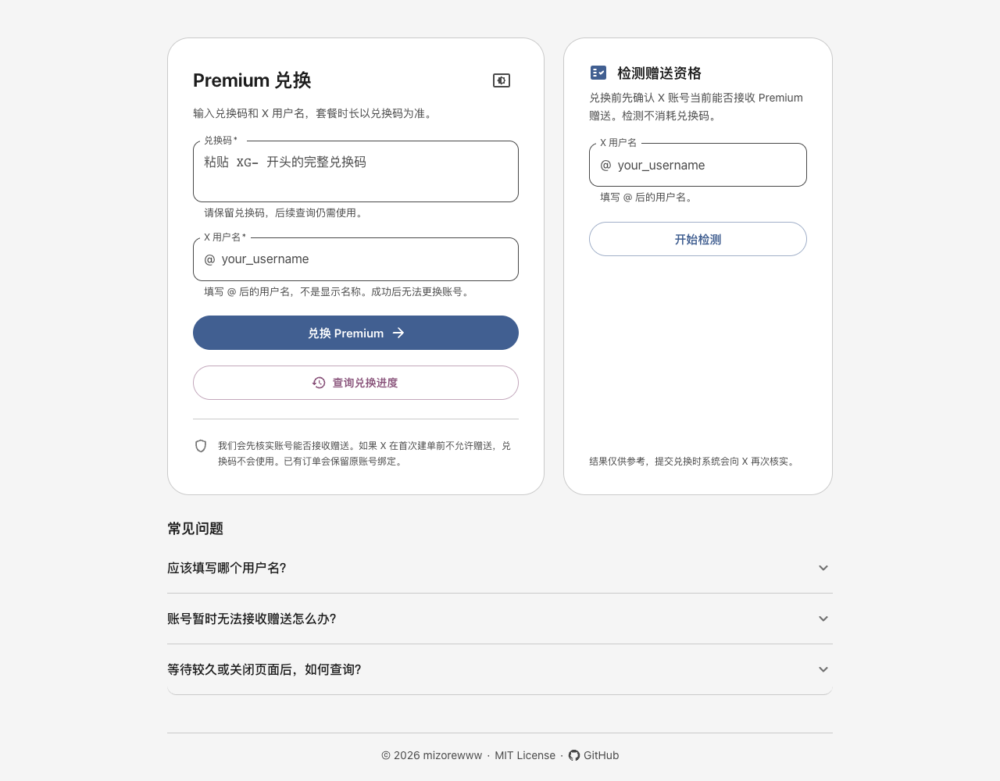
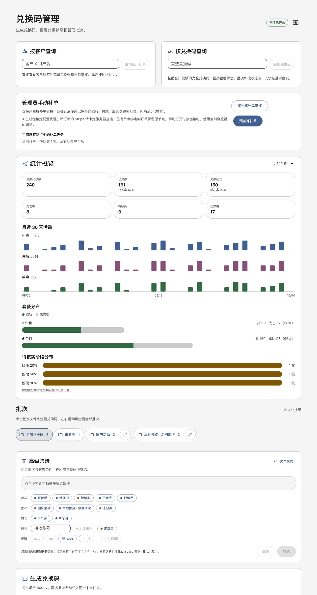
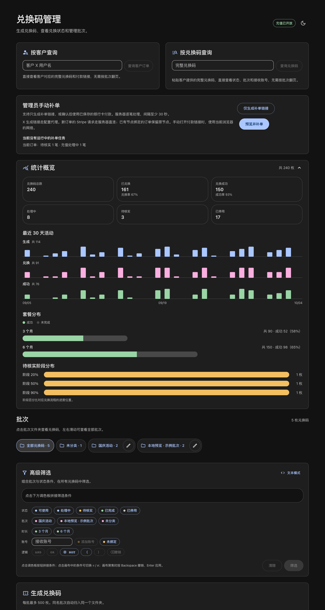

# XGift

**English** | [简体中文](README.zh-CN.md)

An X (Twitter) Premium gift-redemption platform. You generate redemption codes and hand them to your users; a user opens the website, enters a code plus their own X username, and the system automatically places and pays for the Premium gift order.

- **Redemption page**: self-service redemption with live progress updates
- **Admin console**: generate/revoke codes, batch folders, a statistics dashboard, and order status
- **Security**: every credential is stored individually with AES-256-GCM encryption; amount and merchant are verified item by item before paying, and a payment confirmation is only ever submitted once

> This repository is based on [mizorewww/x_gift_bot](https://github.com/mizorewww/x_gift_bot) (MIT License). The original Chinese documentation is preserved in [README.zh-CN.md](README.zh-CN.md). The web UI text is in Chinese, as in the upstream project.

## Screenshots

The screenshots below come from the local mock preview (all data is synthetic):

| Redemption page | Admin console (statistics overview) |
|---|---|
|  |  |

Admin console in dark mode:



## Local preview (no real configuration needed)

Want to look at the interface first? You only need Node.js 22.19+:

```sh
npm ci
npm run build
npm run preview
```

Open http://127.0.0.1:4173 for the redemption page and http://127.0.0.1:4173/admin for the admin console. All data is in-memory sample data and nothing connects to real services. On the redemption page, enter `XG-` followed by 48 letters `A` to see the complete success flow.

## Repository layout

| Path | Contents |
|---|---|
| `cmd/xgift` | Admin CLI: setup wizard, vault management, card pool, proxy checks |
| `cmd/xgift-web` | The redemption website + admin console server |
| `cmd/xpg` | `xpg`, a standalone gift *link* generator site (see [docs/xpg.md](docs/xpg.md)) |
| `internal/checkout` | X API / Stripe checkout engine, card × node rotation, reconciliation |
| `internal/site` | HTTP server, redemption queue, admin APIs, embedded front-end assets |
| `internal/vault` | AES-256-GCM encrypted SQLite vault |
| `internal/proxy` | sing-box based outbound/proxy pool |
| `internal/chrome` | macOS Chrome cookie import |
| `internal/xpg` | Server for the standalone link generator |
| `frontend/` | React 19 + MUI 7 sources, build/preview scripts and tests |
| `deploy/` | systemd units, Caddyfile template, env file examples |
| `docs/` | Payment outbound pool, regeneration and xpg documentation |

## Quick install on Ubuntu (server already running Caddy)

If your server already has Caddy installed from the official package, the installer does steps 2–5 below for you using the prebuilt [release](https://github.com/mouno19/X-Gift/releases) binaries:

```sh
curl -fLo /tmp/xgift-linux-amd64-v1.0.0.tar.gz https://github.com/mouno19/X-Gift/releases/download/v1.0.0/xgift-linux-amd64-v1.0.0.tar.gz
curl -fLo /tmp/install-ubuntu.sh https://raw.githubusercontent.com/mouno19/X-Gift/main/deploy/install-ubuntu.sh
sudo bash /tmp/install-ubuntu.sh xp.example.com      # your hostname, already pointing at the server
sudo /opt/xgift/finish-setup.sh                      # wizard: X cookies, card, proxy, Stripe key; then starts the site
```

- **Paths and service:** it installs to `/opt/xgift`, `/etc/xgift` and `/var/lib/xgift`, and runs everything under a dedicated `xgift` system user.
- **Payments start off:** `XGIFT_PAYMENTS_ENABLED=false` is written to `/etc/xgift/site.env`.
- **Caddy:** it adds one site block to `/etc/caddy/Caddyfile` after taking a timestamped backup. It validates the config before a graceful reload, and no other site is touched.
- **No domain yet?** Use `<name>.<server-ip-with-dashes>.sslip.io`, for example `xgift.203-0-113-10.sslip.io`.
- **Behind Cloudflare?** The installer's site block takes the client IP from the direct connection. If you proxy through Cloudflare, use the `deploy/Caddyfile` template instead.
- **After installing:** run `xgift status`, `xgift cards list` and the other CLI commands as any sudo user. To read the admin password, run `sudo cat /etc/xgift/admin-password`.

## Deployment guide

### Step 1: Prepare the following

Have these four things ready before deploying — the setup wizard asks for each of them:

1. **X login cookies** (`auth_token` and `ct0`): log in to x.com in your browser, press F12 to open DevTools → Application → Cookies → `https://x.com`, and copy these two values. These are the credentials the system uses to send gifts as your X account.
2. **Payment card(s) (one or more)**: card number, expiry, CVC, plus the cardholder name registered with the issuing bank, the billing e-mail and the billing country (two-letter code, e.g. `BD`). Multiple cards are stored encrypted on the server and rotated randomly; new cards can reuse the same billing profile. Only enter genuine information.
3. **Proxy (optional)**: if the server can reach x.com directly, choose "direct"; otherwise prepare a proxy node. Any sing-box outbound type is supported (anytls, socks, http, shadowsocks, vmess, vless, trojan, …), or you can paste a complete sing-box configuration.
4. **Stripe publishable key**: the `pk_live_…` key used by the X checkout page. The wizard explains this when you use the default X Premium catalog; the key is saved in the "catalog" configuration together with the merchant, product and prices, and everything can be customised.

Network paths are configured independently: the X account and eligibility checks always go direct; the regional price check required to create a payment link and the link creation itself share the same `proxy` exit, so that currency and amount do not change between regions; X requests never read environment proxies; Stripe can use a `payment-outbounds` node pool that may include `direct`. Connection failures trigger a 30-minute cooldown, safe read queries try at most 3 exits, and payment confirmations are never replayed automatically. When the pool is not configured or is an empty array, new orders go direct. Stripe never reads environment proxies. See [payment outbound pool configuration](docs/payment-outbounds.md) for details. When you open a Stripe link directly in a browser, the browser's own network is used.

You will also need a Linux server, a domain pointing at that server, and Go 1.27+ on the server (or build on your own machine and upload the binaries).

### Step 2: Build

```sh
git clone https://github.com/mouno19/X-Gift.git
cd X-Gift
npm ci && npm run build        # build the front end (assets are committed, so this is optional)
go build -tags with_quic,with_utls -o bin/xgift ./cmd/xgift
go build -tags with_quic,with_utls -o bin/xgift-web ./cmd/xgift-web
go build -tags with_quic,with_utls -o bin/xpg ./cmd/xpg   # optional standalone link generator
```

`go-sqlite3` uses cgo, so a C compiler (`gcc`) must be available when building.

### Step 3: Run the setup wizard

```sh
./bin/xgift setup
```

The wizard walks you through the configuration step by step (its prompts are in Chinese):

1. **Password file** — generates a random password used to encrypt the vault and saves it at the path you choose (default `sqlite/vault-password`, readable only by you). **Back this file up — if it is lost, none of the encrypted data can be recovered.**
2. **X credentials** — paste the two cookies from step 1.
3. **Payment card** — enter the card and billing details (the card number is validated automatically). To enable multi-card rotation, add more cards with `xgift cards add` after the wizard; missing billing fields are inherited automatically.
4. **Proxy** — choose direct, fill in an AnyTLS node as prompted, or paste a sing-box configuration; it is actually started and validated before being saved.
5. **Stripe publishable key** — paste the `pk_live_` key.
6. **Product catalog** — press Enter to use the default X Premium catalog (3/6-month plans), or customise merchant, currency and plans.
7. **Site configuration** — enter your domain (e.g. `https://xp.example.com`); the wizard generates `site.env` and a random admin password (shown only once and also saved to a file).

Then run `./bin/xgift status`; when all six records show `verified`, setup succeeded.

### Step 4: Start the website

Put the generated `site.env`, `admin-password` and `vault-password` in a safe directory (in production `/etc/xgift/` with mode 0600 is recommended), then:

```sh
sudo systemctl link $PWD/deploy/xgift.service   # or copy it to /etc/systemd/system/
# edit the paths in deploy/xgift.service to match your installation
sudo systemctl enable --now xgift
```

`site.env` fields:

| Field | Description |
|---|---|
| `XGIFT_ORIGIN` | Full site origin (starting with `https://`) |
| `XGIFT_LISTEN` | Listen address, loopback only, e.g. `127.0.0.1:8787` |
| `XGIFT_DATA_DIR` | Data directory (where `vault.db` and `site.db` live) |
| `XGIFT_PASSWORD_FILE` | Path to the vault password file |
| `XGIFT_ADMIN_PASSWORD_FILE` | Path to the admin password file |
| `XGIFT_PAYMENTS_ENABLED` | `true` opens redemptions, `false` pauses them (codes are not consumed) |
| `XGIFT_TURNSTILE_SITE_KEY` / `XGIFT_TURNSTILE_SECRET_FILE` | Optional: set both to enable server-verified Cloudflare Turnstile on public submissions |

### Step 5: Configure an HTTPS reverse proxy

The program only listens on a local port, so Caddy (or any reverse proxy) must provide HTTPS. `deploy/Caddyfile` is a template: replace `xp.example.com` with your domain, put it in Caddy's configuration directory and reload. By default the template only admits Cloudflare origin IPs; if you do not use Cloudflare, remove the `@cloudflare` sections and keep the `reverse_proxy`.

Verify:

```sh
curl https://your-domain/healthz     # {"ok":true,...} means success
```

### Step 6: Start using it

Open `https://your-domain/admin` in a browser and log in with user `admin` and the password generated by the wizard:

1. In "Generate codes" choose a plan, a quantity and a batch name, click generate, then copy or download the codes and send them to your users.
2. The "Statistics overview" at the top shows redemption progress and success rate at any time.
3. Users open `https://your-domain`, enter their code and X username, and the top-up completes.

## Day-to-day maintenance

```sh
./bin/xgift status              # check that every encrypted record is intact
./bin/xgift check               # test that the proxy can reach x.com
./bin/xgift import-chrome       # macOS: re-import the X cookies from local Chrome (when they expire)
```

Update configuration with `put` (reads the new value from standard input):

```sh
./bin/xgift cards list                                     # show the card pool and current rotation combo (last 4 digits only)
echo '{"number":"...","exp_month":"05","exp_year":"2031","cvc":"123"}' | ./bin/xgift cards add
echo 'new ct0 etc. JSON' | ./bin/xgift put --name cookies   # also card / cards / proxy / api-auth
echo 'pk_live_new_key' | ./bin/xgift put --name stripe-key
echo '{"merchant":"acct_...","currency":"bdt","plans":[...]}' | ./bin/xgift put --name catalog
```

Payment cards rotate randomly by "card × node" combination: every 3 consecutive orders use the same combination; after any decline the combination is changed immediately and the declined card enters a 30-minute cooldown (other cards keep rotating); manual recovery follows the same logic. When the payment processor explicitly returns `do_not_try_again`, that card is blocked permanently until explicitly unblocked. `cards add` adds or updates a card (same number replaces), `cards remove --last4 1234` removes one, `cards rotate` ends the current combination immediately, and `cards unblock` clears cooldowns and permanent blocks.

## FAQ

**I lost the password file — what now?** It cannot be recovered. All encrypted data is void; delete `vault.db` and run `xgift setup` again. Back it up together with the databases.

**The X cookies expired?** On macOS run `./bin/xgift import-chrome` to refresh them in one step; on other systems copy them from the browser again and update with `put --name cookies`.

**How do I pause top-ups?** Set `XGIFT_PAYMENTS_ENABLED` in `site.env` to `false` and restart the service. Redemptions are politely declined and codes are not consumed.

**What happens when a payment is declined?** An explicit decline shows a failure explanation and blocks resubmission; automatic verification is no longer shown. The web site and CLI run payments under the same `checkout.lock`, with at least 30 seconds between submissions, and the interval survives restarts. Cards rotate by "card × node" combination, 3 consecutive orders per combination; an ordinary decline ends the current combination immediately and **first cools down that exit node and its shared IP (30 minutes)**, so the same card can continue on another node. Only when the same card is declined on two different nodes is the whole card cooled down for 30 minutes. Other cards keep rotating and the next submission (including recovery) automatically moves to a new combination; consecutive declines never pause the whole site. When the processor explicitly returns `do_not_try_again`, only that card is permanently blocked; the site pauses only when every card is permanently blocked, and `xgift cards unblock` lifts this explicitly (also clearing cooldowns — it cannot be lifted from the recovery confirmation dialog). The admin recovery page shows each card's available/cooling status and the current combination in real time. The command never pays and never changes `XGIFT_PAYMENTS_ENABLED`. After completing the original bill manually, you can look up the original order to verify its success status.

**What if a payment outcome is unknown?** The system would rather mark an order "pending verification" than charge twice. The user clicks "Re-check and continue redemption" with the original code to reconcile automatically; once success is confirmed the status is filled in.

**How do I upgrade?** Rebuild the binaries, back up the data directory and password files, replace the binaries and run `systemctl restart xgift`. Never overwrite the live databases.

## Data and security

- `vault.db`: all sensitive data (cookies, cards, proxies, orders) is encrypted record by record with AES-256-GCM; the key is derived from the password file. Without the password file nobody can read it.
- `site.db`: redemption codes are stored only as digests plus their last characters, never in plain text; usernames and statuses are plain text. Restrict the file permissions.
- All secret files are 0600 (owner-readable only); the admin console uses HTTPS Basic Auth; the APIs are rate-limited and enforce same-origin checks.

### Admin manual recovery

Log in to `/admin` and use "Preview and recover" to see every `review` order, each amount and the last four digits of the current rotation card; tick the confirmation and click "Confirm payment and start recovery". Recovery shares the card × node rotation logic with normal payments: a declined order moves to a new combination and subsequent orders in the same batch keep using it. **This performs real payments** and is independent of the public `XGIFT_PAYMENTS_ENABLED` switch; previews, status queries, deployments and service restarts never start a payment. A preview is valid for 10 minutes and must be redone when the card pool or order contents change.

Recovery runs serially in the server background, waiting at least 30 seconds between orders and keeping the global payment interval. Each order is attempted at most once per batch; already-paid orders only sync their result, and unknown outcomes, bank verification, do-not-retry instructions and mismatched bills are never repaid. A valid session is reused after re-verifying merchant, customer, plan, amount and evidence of uncollected/unauthorised amounts. When an old session has expired, the admin must confirm that the original order was not charged; the system additionally requires the original explicit decline, the matching failed lookup record, and freshly passed account-eligibility and price checks before archiving the old order and generating a new link. Unknown outcomes and do-not-retry instructions are never released by that confirmation. Each original session allows at most 3 manual retries.

"Stop remaining orders" lets the current order finish verification and then stops. Closing the browser does not affect the job; a service restart marks a running job as interrupted and never resumes charging automatically. Jobs and history are stored in the encrypted vault under `admin-recovery:*`, original payment records under `manual-previous:*`, verification evidence under `manual-preflight:*` and diagnostic errors under `manual-recovery-error:*`. The page only shows card last-four digits and never accepts card numbers or security codes.

"Look up codes by customer / single recovery" in the admin console accepts an X username, reads bound orders across batches, decrypts and verifies the full code, and shows the current payment link. "View code / recover" in the code list opens the same detail view. Historical codes stored only as hashes cannot be restored, but single recovery uses the order ID directly and does not depend on the plaintext code.

"Generate recovery link only" and "Single recovery" create previews in `links` and `pay` mode respectively; the former never calls card tokenisation or payment confirmation on the server and does not lift payment protection. Both modes only handle the customer bound to the preview. Expired-bill replacement uses an atomic vault transaction to store a `replacement-original:<old session>` audit and install the new order record. A valid unpaid link is reused directly; a newly generated link can be viewed in the customer details. Server restarts never continue a job automatically.

## Further documentation

- [Stripe payment outbound pool](docs/payment-outbounds.md) (Chinese)
- [Explicit public payment-link regeneration](docs/payment-regeneration.md) (English)
- [xpg — standalone gift link generator](docs/xpg.md) (Chinese)

## Credits and license

Based on [mizorewww/x_gift_bot](https://github.com/mizorewww/x_gift_bot) by mizorewww. Released under the [MIT License](LICENSE).
